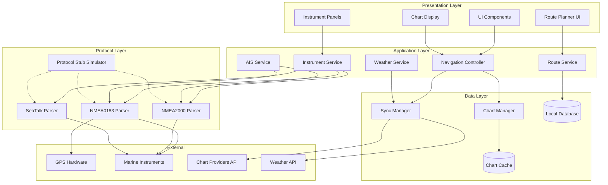

# Marine Navigation System - Design Document

## Implementation Status

**Current Completion: ~40%**

### ✅ Completed Components
- Protocol Parsers (NMEA0183, NMEA2000, SeaTalk) - 100%
- Protocol Stub Simulator - 100%
- Type Definitions - 100%
- InstrumentService (stub mode only) - 75%
- RouteService - 90%
- AISService - 90%
- Database Repositories (code only, not initialized) - 100%

### 🔴 Critical Blockers
1. **Database Not Initialized** - SQLite schema not created, repositories will fail
2. **No Tests Written** - Zero unit/integration tests despite framework configured
3. **No UI Components** - Empty components directory, no user interface
4. **Physical Hardware Missing** - Serial/network connections not implemented
5. **Skeleton Services** - 9 services are empty stubs (ChartManager, WeatherService, TideService, TrackService, LogbookService, SafetyService, SettingsService, SyncManager, ErrorHandler)

### ⚠️ Missing Dependencies
- ESLint and plugins
- SQLite library (react-native-sqlite-storage)
- Mapbox library (@rnmapbox/maps)
- Serialport library
- React Native File System

### 📋 Priority Order
1. Install missing dependencies
2. Initialize SQLite database
3. Write unit tests for protocol parsers
4. Implement physical hardware connections
5. Complete skeleton service implementations
6. Create UI components
7. Integrate with Redux
8. Add error handling throughout

## Overview

The Marine Navigation System is a cross-platform application designed to run on tablets with offline-first architecture. The system follows a modular design with clear separation between the presentation layer, business logic, and data access layers. The architecture prioritizes offline capability, real-time data processing from marine instruments, and responsive touch-based interaction.

### Technology Stack

- **Frontend Framework**: React with TypeScript for type safety and component reusability
- **UI Framework**: React Native for cross-platform tablet support (iOS/Android)
- **State Management**: Redux Toolkit for predictable state management
- **Mapping Engine**: Mapbox GL JS / React Native Mapbox for vector chart rendering
- **Local Storage**: SQLite for structured data, IndexedDB/AsyncStorage for chart tiles
- **Protocol Communication**: Node.js serialport library for NMEA protocols, WebSocket for network protocols
- **Testing**: Jest for unit tests, React Native Testing Library, Protocol stub simulators

## Architecture

### High-Level Architecture



### Offline-First Architecture

The system implements an offline-first strategy where all critical functionality works without internet connectivity:

1. **Data Synchronization**: Background sync when online, queue operations when offline
2. **Chart Caching**: Pre-download chart tiles for selected regions
3. **Local Database**: SQLite stores routes, waypoints, tracks, logbook, and settings
4. **Service Workers**: Handle background data sync and cache management

## Components and Interfaces

### 1. Chart Display Component

**Responsibilities:**
- Render vector and raster nautical charts
- Display vessel position with heading indicator
- Show routes, waypoints, and tracks
- Render AIS targets and navigation aids
- Handle touch gestures (pan, zoom, rotate)

**Key Interfaces:**

```typescript
interface ChartDisplayProps {
  position: Position;
  heading: number;
  zoom: number;
  rotation: ChartRotation;
  routes: Route[];
  aisTargets: AISTarget[];
  chartLayers: ChartLayer[];
  onMapInteraction: (event: MapInteractionEvent) => void;
}

interface Position {
  latitude: number;
  longitude: number;
  accuracy: number;
  timestamp: number;
}

enum ChartRotation {
  NorthUp = 'north-up',
  HeadingUp = 'heading-up'
}

interface ChartLayer {
  id: string;
  type: 'vector' | 'raster' | 'weather' | 'tide';
  visible: boolean;
  opacity: number;
  source: string;
}
```

### 2. Route Service

**Responsibilities:**
- Create, update, and delete routes
- Calculate route distances and bearings
- Validate routes against chart data (depth, hazards)
- Provide navigation guidance along active route
- Import/export routes in standard formats (GPX)

**Key Interfaces:**

```typescript
interface RouteService {
  createRoute(waypoints: Waypoint[]): Promise<Route>;
  updateRoute(routeId: string, waypoints: Waypoint[]): Promise<Route>;
  deleteRoute(routeId: string): Promise<void>;
  calculateRoute(start: Position, end: Position): Promise<Route>;
  validateRoute(route: Route): Promise<RouteValidation>;
  getActiveRoute(): Promise<Route | null>;
  setActiveRoute(routeId: string): Promise<void>;
  exportRoute(routeId: string, format: 'gpx' | 'kml'): Promise<string>;
}

interface Route {
  id: string;
  name: string;
  waypoints: Waypoint[];
  totalDistance: number;
  estimatedDuration: number;
  createdAt: Date;
  updatedAt: Date;
}

interface Waypoint {
  id: string;
  position: Position;
  name: string;
  description?: string;
  arrivalRadius: number;
}

interface RouteValidation {
  isValid: boolean;
  warnings: RouteWarning[];
}

interface RouteWarning {
  type: 'shallow_water' | 'hazard' | 'restricted_area';
  position: Position;
  message: string;
  severity: 'low' | 'medium' | 'high';
}
```

### 3. Instrument Service

**Responsibilities:**
- Manage connections to marine instruments
- Parse protocol data (NMEA0183, NMEA2000, SeaTalk)
- Distribute instrument data to subscribers
- Handle connection errors and reconnection
- Support protocol stub mode for testing

**Key Interfaces:**

```typescript
interface InstrumentService {
  connect(config: InstrumentConfig): Promise<void>;
  disconnect(): Promise<void>;
  subscribe(dataType: InstrumentDataType, callback: DataCallback): Subscription;
  getLatestData(dataType: InstrumentDataType): InstrumentData | null;
  setStubMode(enabled: boolean): void;
}

interface InstrumentConfig {
  protocol: 'nmea0183' | 'nmea2000' | 'seatalk';
  connection: SerialConnection | NetworkConnection;
  baudRate?: number;
  useStub?: boolean;
}

interface SerialConnection {
  type: 'serial';
  port: string;
}

interface NetworkConnection {
  type: 'network';
  host: string;
  port: number;
}

enum InstrumentDataType {
  GPS = 'gps',
  Depth = 'depth',
  Wind = 'wind',
  Speed = 'speed',
  Heading = 'heading',
  Temperature = 'temperature',
  AIS = 'ais'
}

interface InstrumentData {
  type: InstrumentDataType;
  value: any;
  unit: string;
  timestamp: number;
  source: string;
}

type DataCallback = (data: InstrumentData) => void;

interface Subscription {
  unsubscribe(): void;
}
```

### 4. Protocol Parsers

**NMEA0183 Parser:**

```typescript
interface NMEA0183Parser {
  parse(sentence: string): NMEA0183Message | null;
  validate(sentence: string): boolean;
  calculateChecksum(sentence: string): string;
}

interface NMEA0183Message {
  sentenceId: string;
  fields: string[];
  checksum: string;
  raw: string;
}

// Supported sentences: GGA, RMC, GLL, VTG, DBT, DPT, MWV, VHW, HDG, VDM, VDO
```

**NMEA2000 Parser:**

```typescript
interface NMEA2000Parser {
  parse(message: Buffer): NMEA2000Message | null;
  getPGN(message: Buffer): number;
  extractFields(message: NMEA2000Message): Record<string, any>;
}

interface NMEA2000Message {
  pgn: number;
  priority: number;
  source: number;
  destination: number;
  data: Buffer;
  timestamp: number;
}

// Supported PGNs: 126992 (System Time), 127250 (Heading), 127251 (Rate of Turn),
// 128259 (Speed), 128267 (Depth), 129025 (Position), 129026 (COG/SOG),
// 129029 (GNSS Position), 130306 (Wind), 130310 (Water Temperature)
```

**SeaTalk Parser:**

```typescript
interface SeaTalkParser {
  parse(data: Buffer): SeaTalkMessage | null;
  getCommandByte(data: Buffer): number;
}

interface SeaTalkMessage {
  command: number;
  data: Buffer;
  interpretation: Record<string, any>;
  timestamp: number;
}

// Supported commands: 0x00 (Depth), 0x10 (Apparent Wind Angle),
// 0x11 (Apparent Wind Speed), 0x20 (Speed through Water), 0x84 (Heading)
```

### 5. Protocol Stub Simulator

**Responsibilities:**
- Generate realistic marine instrument data
- Simulate GPS movement along predefined tracks
- Produce valid protocol messages
- Support configurable update rates and values
- Enable deterministic testing scenarios

**Key Interfaces:**

```typescript
interface ProtocolStub {
  start(config: StubConfig): void;
  stop(): void;
  setScenario(scenario: SimulationScenario): void;
  updateValue(dataType: InstrumentDataType, value: any): void;
}

interface StubConfig {
  protocols: ('nmea0183' | 'nmea2000' | 'seatalk')[];
  updateRate: number; // Hz
  outputMode: 'serial' | 'network' | 'callback';
  connection?: SerialConnection | NetworkConnection;
}

interface SimulationScenario {
  name: string;
  gpsTrack?: Position[];
  depth?: DepthProfile;
  wind?: WindProfile;
  speed?: SpeedProfile;
  aisTargets?: AISTarget[];
}

interface DepthProfile {
  values: number[];
  interval: number; // seconds
}

interface WindProfile {
  speed: number;
  direction: number;
  variation: number; // random variation percentage
}

interface SpeedProfile {
  speed: number;
  variation: number;
}
```

### 6. AIS Service

**Responsibilities:**
- Process AIS messages from NMEA streams
- Track vessel positions and update history
- Calculate CPA (Closest Point of Approach)
- Manage AIS target lifecycle
- Provide collision warnings

**Key Interfaces:**

```typescript
interface AISService {
  processMessage(message: NMEA0183Message | NMEA2000Message): void;
  getTargets(bounds?: GeoBounds): AISTarget[];
  getTarget(mmsi: string): AISTarget | null;
  subscribe(callback: (target: AISTarget) => void): Subscription;
}

interface AISTarget {
  mmsi: string;
  name: string;
  callSign: string;
  position: Position;
  course: number;
  speed: number;
  heading: number;
  vesselType: number;
  length: number;
  width: number;
  lastUpdate: Date;
  history: Position[];
  cpa?: CPAInfo;
}

interface CPAInfo {
  distance: number; // nautical miles
  time: number; // minutes
  position: Position;
}

interface GeoBounds {
  north: number;
  south: number;
  east: number;
  west: number;
}
```

### 7. Chart Manager

**Responsibilities:**
- Load and cache chart data
- Manage chart tile downloads
- Handle multiple chart formats (S-57 ENC, raster)
- Provide chart metadata and coverage information
- Manage chart updates

**Key Interfaces:**

```typescript
interface ChartManager {
  loadChart(region: GeoBounds, zoomLevels: number[]): Promise<void>;
  getChartTile(x: number, y: number, z: number): Promise<ChartTile>;
  getCoverage(): Promise<ChartCoverage[]>;
  checkUpdates(): Promise<ChartUpdate[]>;
  downloadUpdate(updateId: string): Promise<void>;
  clearCache(region?: GeoBounds): Promise<void>;
}

interface ChartTile {
  x: number;
  y: number;
  z: number;
  data: Buffer;
  format: 'vector' | 'raster';
  cached: boolean;
}

interface ChartCoverage {
  id: string;
  name: string;
  bounds: GeoBounds;
  edition: string;
  issueDate: Date;
  scale: number;
  format: 'enc' | 'raster';
}

interface ChartUpdate {
  id: string;
  chartId: string;
  version: string;
  releaseDate: Date;
  size: number;
  description: string;
}
```

### 8. Weather Service

**Responsibilities:**
- Fetch weather forecasts from online sources
- Cache weather data for offline access
- Provide weather overlays for chart display
- Parse GRIB weather data
- Manage weather alerts

**Key Interfaces:**

```typescript
interface WeatherService {
  getForecast(position: Position, days: number): Promise<WeatherForecast>;
  getWeatherOverlay(bounds: GeoBounds, layer: WeatherLayer): Promise<WeatherData>;
  getAlerts(bounds: GeoBounds): Promise<WeatherAlert[]>;
  cacheRegion(bounds: GeoBounds): Promise<void>;
}

interface WeatherForecast {
  position: Position;
  forecasts: WeatherPoint[];
}

interface WeatherPoint {
  timestamp: Date;
  windSpeed: number;
  windDirection: number;
  waveHeight: number;
  wavePeriod: number;
  temperature: number;
  pressure: number;
  precipitation: number;
}

enum WeatherLayer {
  Wind = 'wind',
  Waves = 'waves',
  Precipitation = 'precipitation',
  Pressure = 'pressure'
}

interface WeatherData {
  layer: WeatherLayer;
  bounds: GeoBounds;
  data: number[][][]; // 3D array: [lat][lon][value]
  timestamp: Date;
}

interface WeatherAlert {
  id: string;
  type: string;
  severity: 'warning' | 'watch' | 'advisory';
  area: GeoBounds;
  message: string;
  validFrom: Date;
  validTo: Date;
}
```

### 9. Track Recording Service

**Responsibilities:**
- Record vessel position history
- Manage track storage and retrieval
- Export tracks in standard formats
- Convert tracks to routes
- Optimize track storage

**Key Interfaces:**

```typescript
interface TrackService {
  startRecording(name: string): Promise<string>;
  stopRecording(): Promise<void>;
  getTrack(trackId: string): Promise<Track>;
  getTracks(filter?: TrackFilter): Promise<Track[]>;
  exportTrack(trackId: string, format: 'gpx' | 'kml'): Promise<string>;
  convertToRoute(trackId: string): Promise<Route>;
  deleteTrack(trackId: string): Promise<void>;
}

interface Track {
  id: string;
  name: string;
  points: TrackPoint[];
  startTime: Date;
  endTime: Date;
  distance: number;
  maxSpeed: number;
  avgSpeed: number;
}

interface TrackPoint {
  position: Position;
  speed: number;
  heading: number;
  timestamp: Date;
}

interface TrackFilter {
  startDate?: Date;
  endDate?: Date;
  minDistance?: number;
}
```

### 10. Logbook Service

**Responsibilities:**
- Automatically record voyage information
- Store logbook entries
- Allow manual notes and entries
- Export logbook data
- Calculate voyage statistics

**Key Interfaces:**

```typescript
interface LogbookService {
  startVoyage(): Promise<string>;
  endVoyage(): Promise<void>;
  addEntry(entry: LogbookEntry): Promise<void>;
  getEntries(filter?: LogbookFilter): Promise<LogbookEntry[]>;
  exportLogbook(format: 'csv' | 'pdf'): Promise<string>;
}

interface LogbookEntry {
  id: string;
  voyageId: string;
  timestamp: Date;
  position: Position;
  type: 'voyage_start' | 'voyage_end' | 'waypoint' | 'note' | 'event';
  distance?: number;
  avgSpeed?: number;
  maxSpeed?: number;
  notes?: string;
}

interface LogbookFilter {
  startDate?: Date;
  endDate?: Date;
  voyageId?: string;
}
```

## Data Models

### Database Schema

```sql
-- Routes and Waypoints
CREATE TABLE routes (
  id TEXT PRIMARY KEY,
  name TEXT NOT NULL,
  total_distance REAL,
  estimated_duration INTEGER,
  created_at INTEGER NOT NULL,
  updated_at INTEGER NOT NULL
);

CREATE TABLE waypoints (
  id TEXT PRIMARY KEY,
  route_id TEXT NOT NULL,
  position_lat REAL NOT NULL,
  position_lon REAL NOT NULL,
  name TEXT NOT NULL,
  description TEXT,
  arrival_radius REAL DEFAULT 50,
  sequence_order INTEGER NOT NULL,
  FOREIGN KEY (route_id) REFERENCES routes(id) ON DELETE CASCADE
);

-- Tracks
CREATE TABLE tracks (
  id TEXT PRIMARY KEY,
  name TEXT NOT NULL,
  start_time INTEGER NOT NULL,
  end_time INTEGER,
  distance REAL,
  max_speed REAL,
  avg_speed REAL
);

CREATE TABLE track_points (
  id INTEGER PRIMARY KEY AUTOINCREMENT,
  track_id TEXT NOT NULL,
  position_lat REAL NOT NULL,
  position_lon REAL NOT NULL,
  speed REAL,
  heading REAL,
  timestamp INTEGER NOT NULL,
  FOREIGN KEY (track_id) REFERENCES tracks(id) ON DELETE CASCADE
);

CREATE INDEX idx_track_points_track_id ON track_points(track_id);
CREATE INDEX idx_track_points_timestamp ON track_points(timestamp);

-- Logbook
CREATE TABLE voyages (
  id TEXT PRIMARY KEY,
  start_time INTEGER NOT NULL,
  end_time INTEGER,
  start_position_lat REAL,
  start_position_lon REAL,
  end_position_lat REAL,
  end_position_lon REAL,
  distance REAL,
  avg_speed REAL,
  max_speed REAL
);

CREATE TABLE logbook_entries (
  id TEXT PRIMARY KEY,
  voyage_id TEXT NOT NULL,
  timestamp INTEGER NOT NULL,
  position_lat REAL,
  position_lon REAL,
  type TEXT NOT NULL,
  notes TEXT,
  FOREIGN KEY (voyage_id) REFERENCES voyages(id) ON DELETE CASCADE
);

-- AIS Targets
CREATE TABLE ais_targets (
  mmsi TEXT PRIMARY KEY,
  name TEXT,
  call_sign TEXT,
  position_lat REAL,
  position_lon REAL,
  course REAL,
  speed REAL,
  heading REAL,
  vessel_type INTEGER,
  length REAL,
  width REAL,
  last_update INTEGER NOT NULL
);

CREATE TABLE ais_history (
  id INTEGER PRIMARY KEY AUTOINCREMENT,
  mmsi TEXT NOT NULL,
  position_lat REAL NOT NULL,
  position_lon REAL NOT NULL,
  timestamp INTEGER NOT NULL,
  FOREIGN KEY (mmsi) REFERENCES ais_targets(mmsi) ON DELETE CASCADE
);

CREATE INDEX idx_ais_history_mmsi ON ais_history(mmsi);
CREATE INDEX idx_ais_history_timestamp ON ais_history(timestamp);

-- Settings
CREATE TABLE settings (
  key TEXT PRIMARY KEY,
  value TEXT NOT NULL,
  updated_at INTEGER NOT NULL
);

-- Chart Cache Metadata
CREATE TABLE chart_cache (
  tile_key TEXT PRIMARY KEY,
  x INTEGER NOT NULL,
  y INTEGER NOT NULL,
  z INTEGER NOT NULL,
  format TEXT NOT NULL,
  cached_at INTEGER NOT NULL,
  size INTEGER NOT NULL
);

CREATE INDEX idx_chart_cache_xyz ON chart_cache(x, y, z);
```

## Error Handling

### Error Categories

1. **Connection Errors**: Instrument disconnection, network unavailable
2. **Data Errors**: Invalid protocol messages, corrupted chart data
3. **Storage Errors**: Database full, write failures
4. **Navigation Errors**: GPS signal lost, invalid route
5. **System Errors**: Low battery, insufficient memory

### Error Handling Strategy

```typescript
class NavigationError extends Error {
  constructor(
    message: string,
    public code: ErrorCode,
    public severity: ErrorSeverity,
    public recoverable: boolean
  ) {
    super(message);
  }
}

enum ErrorCode {
  GPS_SIGNAL_LOST = 'GPS_SIGNAL_LOST',
  INSTRUMENT_DISCONNECTED = 'INSTRUMENT_DISCONNECTED',
  CHART_LOAD_FAILED = 'CHART_LOAD_FAILED',
  STORAGE_FULL = 'STORAGE_FULL',
  INVALID_ROUTE = 'INVALID_ROUTE',
  NETWORK_UNAVAILABLE = 'NETWORK_UNAVAILABLE'
}

enum ErrorSeverity {
  INFO = 'info',
  WARNING = 'warning',
  ERROR = 'error',
  CRITICAL = 'critical'
}

interface ErrorHandler {
  handle(error: NavigationError): void;
  subscribe(callback: (error: NavigationError) => void): Subscription;
}
```

### Recovery Strategies

- **GPS Signal Lost**: Switch to dead reckoning using last known position and course
- **Instrument Disconnected**: Attempt automatic reconnection every 5 seconds
- **Chart Load Failed**: Fall back to cached lower resolution charts
- **Storage Full**: Automatically purge old track data and chart cache
- **Network Unavailable**: Queue sync operations for when connection restored

## Testing Strategy

### Unit Testing

- Test each service independently with mocked dependencies
- Protocol parsers: Test with known valid/invalid messages
- Route calculations: Test distance and bearing calculations
- Data validation: Test input validation and error cases

### Integration Testing

- Test protocol stub integration with instrument service
- Test chart manager with local cache
- Test offline/online mode transitions
- Test data synchronization

### Protocol Stub Testing Scenarios

```typescript
const testScenarios = {
  // Scenario 1: Coastal navigation
  coastalNavigation: {
    gpsTrack: generateTrackAlongCoast(),
    depth: { values: [5, 8, 12, 15, 20], interval: 10 },
    wind: { speed: 15, direction: 270, variation: 10 },
    speed: { speed: 6.5, variation: 5 }
  },
  
  // Scenario 2: Harbor approach
  harborApproach: {
    gpsTrack: generateHarborApproach(),
    depth: { values: [20, 15, 10, 8, 5, 3], interval: 5 },
    wind: { speed: 8, direction: 180, variation: 15 },
    speed: { speed: 3.0, variation: 10 },
    aisTargets: generateHarborTraffic()
  },
  
  // Scenario 3: Open water passage
  openWater: {
    gpsTrack: generateStraightTrack(100), // 100 nm
    depth: { values: [50, 60, 70, 80], interval: 60 },
    wind: { speed: 20, direction: 315, variation: 5 },
    speed: { speed: 7.5, variation: 3 }
  }
};
```

### End-to-End Testing

- Complete navigation workflow: Create route → Navigate → Record track
- Offline mode: Disconnect network → Verify full functionality
- Instrument integration: Connect stub → Verify data display
- Emergency functions: Test MOB marker and anchor watch

### Performance Testing

- Chart rendering: Target 60 FPS on tablet hardware
- Position updates: Process within 100ms
- AIS target updates: Handle 100+ targets simultaneously
- Database queries: Route/track queries under 50ms
- Memory usage: Stay under 512MB on tablet

## Security Considerations

- **Data Privacy**: All navigation data stored locally, no cloud requirement
- **Input Validation**: Validate all protocol messages and user inputs
- **Secure Storage**: Encrypt sensitive settings (API keys, credentials)
- **Network Security**: Use HTTPS for all external API calls
- **Permission Management**: Request only necessary device permissions

## Performance Optimization

### Chart Rendering
- Use vector tiles for efficient zoom levels
- Implement tile caching with LRU eviction
- Lazy load chart features based on zoom level
- Use WebGL acceleration where available

### Data Processing
- Throttle position updates to 1Hz for display
- Batch database writes for track recording
- Use worker threads for protocol parsing
- Implement efficient spatial indexing for AIS targets

### Memory Management
- Limit AIS history to 24 hours
- Compress track data older than 7 days
- Implement progressive chart loading
- Clear unused chart tiles from memory

## Deployment Considerations

### Platform Support
- iOS: Minimum iOS 13
- Android: Minimum Android 8.0 (API 26)
- Tablet optimization for 7-13 inch screens

### Distribution
- App stores: Apple App Store, Google Play Store
- Direct APK distribution for Android
- Open source repository on GitHub

### Updates
- Over-the-air updates for app code
- Separate chart data updates
- Backward compatible database migrations
