# OpenSail UI redesign: audit and proposal

Status: **approved by the owner on 2026-10-21**, with the recommended option for every decision in section 3. Being built in the PRs listed in section 4.

The UI grew screen by screen over several phases and was never designed as a whole. This
document lists what is there now, what is broken or duplicated, and proposes one navigation
model and one visual system for the browser, Windows (Tauri) and Android (Capacitor) apps.

- Before screenshots: [`ui-redesign/before/`](ui-redesign/before/) (v0.2.0, simulator running,
  1280x800 desktop, 1024x768 and 768x1024 tablet, 375x812 phone)
- Clickable prototype: [`ui-redesign/prototype.html`](ui-redesign/prototype.html) (open it in a
  browser and resize the window; the moon button switches night mode, `?night` and `#instruments`
  in the URL work too)
- Mockup screenshots of the prototype: [`ui-redesign/mockups/`](ui-redesign/mockups/)

## 1. Audit

### 1.1 What the screens look like now

| Desktop chart | Desktop instruments | Phone chart | Phone sidebar |
|---|---|---|---|
| 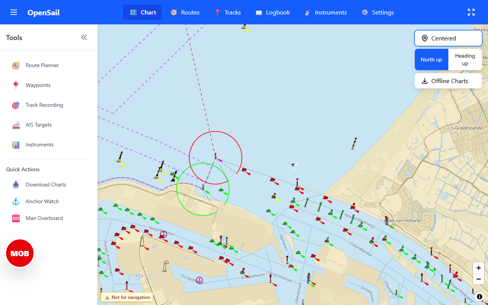 | 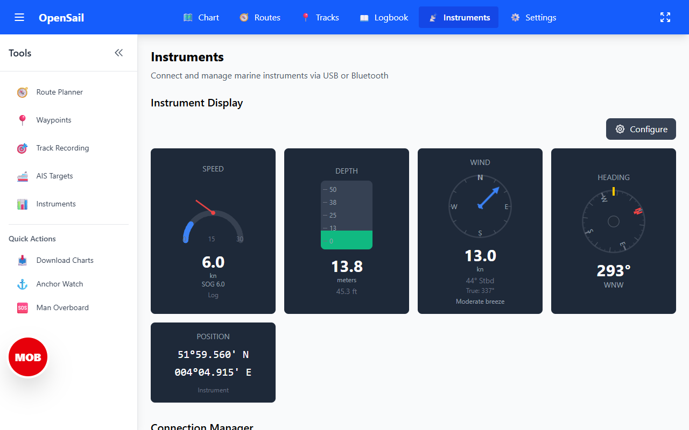 | 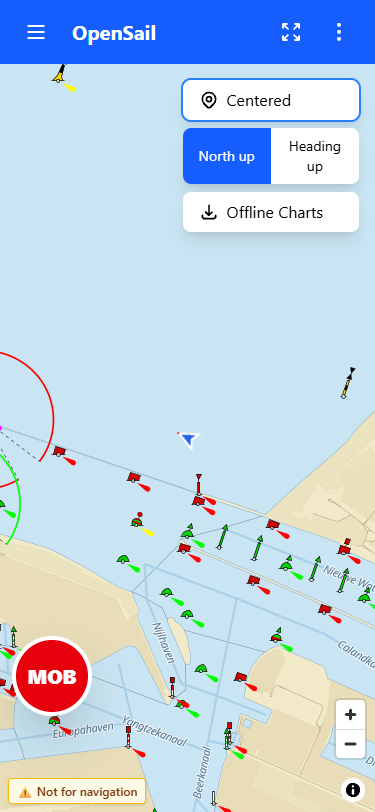 | 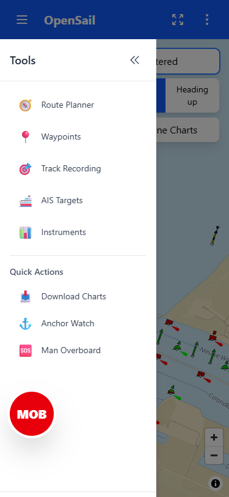 |

| Tablet portrait chart | Phone routes | Phone menu | Desktop Settings (full) |
|---|---|---|---|
| 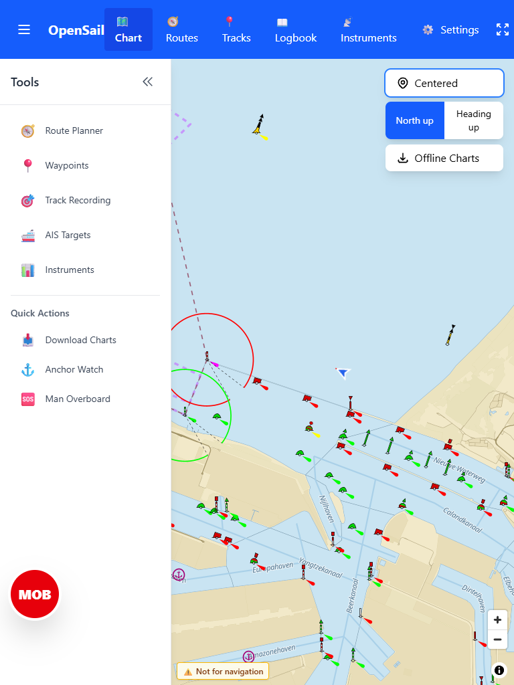 | 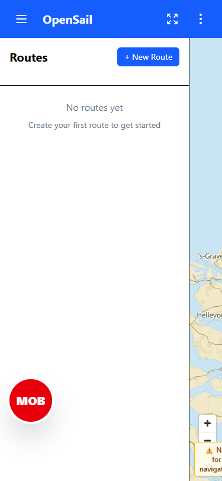 | 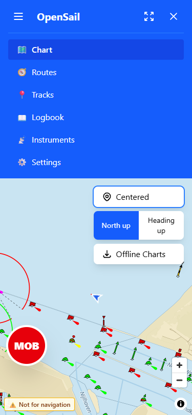 | 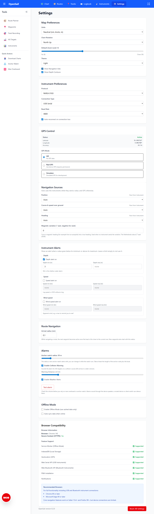 |

### 1.2 Every control, what it does, and whether it works

**Top navigation bar** (`components/layout/Navigation.tsx`)

| Control | Does | Works? | Notes |
|---|---|---|---|
| ☰ Toggle sidebar | Shows/hides the Tools sidebar | Yes | Opens a panel that is mostly dead buttons (below) |
| "OpenSail" | Link to /chart | Yes | Same as the Chart tab |
| Chart / Routes / Tracks / Logbook / Instruments / Settings tabs | Page links | Yes | At 768 px the 6 tabs plus "Settings" wrap to two lines and crowd the bar (tablet portrait screenshot) |
| Logbook | Opens /logbook | Dead end | Page says "will be implemented here" |
| ⛶ Toggle fullscreen | Hides nav and sidebar | Yes | A second ✕ button appears top right to exit. Not real full screen (browser chrome stays) |
| ⋮ Mobile menu (<768 px) | Drop-down with the same 6 tabs | Yes | Third copy of the navigation |

**Tools sidebar** (`components/layout/Sidebar.tsx`), open by default from 768 px up, takes 256 px

| Control | Works? | Where the function really is |
|---|---|---|
| Route Planner | **No** (no `onClick`) | Routes page, "+ New Route" |
| Waypoints | **No** | Inside the route planner on the Routes page |
| Track Recording | **No** | Tracks page, "Start Recording" |
| AIS Targets | **No** | Nothing: there is an AIS layer and store but no AIS data source yet |
| Instruments | **No** | Instruments tab (duplicate) |
| Download Charts | **No** | Chart page, "Offline Charts" button |
| Anchor Watch | Yes | **Only entry point** to anchor watch. On a phone that is ☰ then Anchor Watch, and the sidebar is closed by default there |
| Man Overboard | Yes | Duplicate of the always-visible red MOB button |
| « Collapse | Yes | Collapsed state shows only the 5 dead icons |
| Close (phone) | Yes | |

So 6 of the 8 tool buttons do nothing, and the two that work are a duplicate (MOB) and a
hidden-away safety function (anchor watch).

**Chart page** (`pages/ChartPage.tsx`)

| Control | Works? | Notes |
|---|---|---|
| Centered / Recenter | Yes | Text button; the label flips between a state and an action |
| North up / Heading up | Yes | Also in Settings ("Chart Rotation"): two places |
| Route to navigate + Navigate (when routes exist) | Yes | Also on the Routes page: two places |
| Offline Charts → panel → Select Region on Map | Yes | Also listed as the dead "Download Charts" in the sidebar |
| MapLibre zoom +/- and attribution (i) | Yes | 29 px, below the 44 px minimum |
| MOB (red, 80 px) | Yes | Sits over the chart and over the left of every page, also over Settings content |
| "Not for navigation" | Info | |
| Vessel marker | Shows | Small (about 20 px), easy to lose on a busy ENC |
| AIS target click | Logs to the console only | |
| Layer visibility (routes, tracks, AIS) | Not reachable | `ui.showRoutes/showTracks/showAIS` exist but no control sets them |

**Routes page**: + New Route, per route Navigate/Stop, Edit, Delete, planner with map clicks.
Works. On a phone the route list is a fixed 320 px column, leaving a 55 px sliver of map
(phone routes screenshot).

**Tracks page**: Start/Stop recording, list, per track show/hide, export GPX, to route, delete.
Works. Track recording is not reachable from the chart, where you are when you cast off.

**Instruments page**: Configure (gauge on/off, order, size), connection manager (USB, Bluetooth,
Wi-Fi, Simulator), simulator values, raw "Received Data" JSON, connection tips. Works, but the
page mixes the display a sailor reads with a developer's raw JSON log, and the subtitle still
says "via USB or Bluetooth".

**Settings page**: several settings are stored but **nothing reads them**:

| Setting | Read anywhere? |
|---|---|
| Map: Units, Chart rotation, Default zoom | Yes |
| Map: Theme (light/dark/auto) | **No** |
| Map: Show navigation aids, Show depth contours | **No** |
| Instrument Preferences: Protocol, Connection type, Host, Port, Baud rate, Auto-reconnect | **No**: the Instruments page has its own connection controls |
| GPS Control, Navigation Sources, Instrument Alerts, Route Navigation | Yes |
| Alarms: Anchor radius, Test alarm | Yes |
| Alarms: Collision warning on/off | Stored in alerts, but there is no AIS data yet |
| Alarms: Collision distance, Weather alerts | **No** |
| Offline Mode, Auto-sync | **No** |
| Browser Compatibility | Info, long, developer-oriented |
| Reset All Settings | Yes |

### 1.3 Gauges

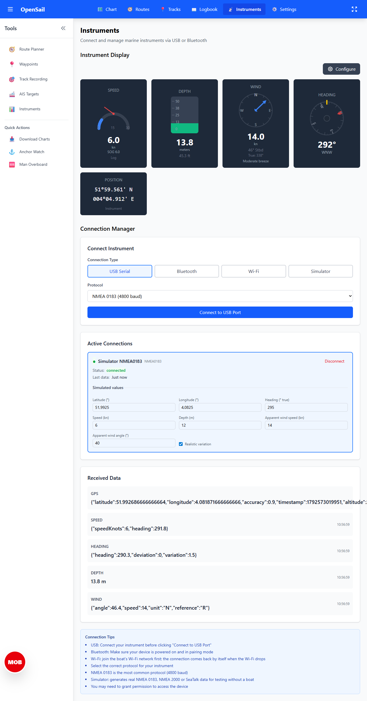

- **Speed looks weird because it is geometrically wrong.** The arc is drawn around (50, 90)
  but the needle turns around (50, 50), the top of the arc. At 0 kn the needle points left from
  the top of the arc, at 6 kn it sticks out above it. The 0/15/30 labels are an HTML overlay
  that does not line up with the SVG, and a 0–30 kn scale wastes most of the dial for a
  sailing yacht doing 4–8 kn.
- **Wind labels apparent wind as "True".** The parser receives `MWV ... R` (relative =
  apparent). The gauge adds the heading to the apparent angle and calls it "True: 338°". That
  is the *apparent* wind direction; true wind needs the boat's speed as well. The dial also
  draws N/E/S/W on a boat-relative angle, so "N" means "bow".
- **Depth**: a bar scaled 0–50 m with 0 at the bottom, so 13.8 m fills from the bottom. It does
  not say where the alarm limit is, and does not show the trend, which is what matters when
  you approach shallow water.
- **Heading**: fine in principle, but the card has N/E/S/W rotated and small, and the lubber
  line is hard to see.
- All four use different sizes, fonts and layouts, and the numbers are 30 px on a 230 px card.

### 1.4 General findings

1. Three copies of the navigation (top tabs, mobile menu, sidebar) and none of them is
   designed for touch: tabs are 40 px tall, sidebar rows 36 px, map buttons 29 px.
2. Safety: MOB is always one tap (good). Anchor watch is two taps on desktop and three on a
   phone, through a sidebar of dead buttons.
3. The chart, the main screen, shows no instrument data at all: to see depth you leave the
   chart.
4. Saturated blue bar (#2563eb) and emoji icons; emoji render differently on Windows and
   Android and are not readable in sunlight.
5. No night mode: a white UI at night ruins night vision.
6. Settings that do nothing make the app feel broken ("I set it and nothing happened").

## 2. Proposal

### 2.1 One navigation model

| Desktop / tablet landscape (≥ 1024 px) | Phone / tablet portrait (< 1024 px) |
|---|---|
| 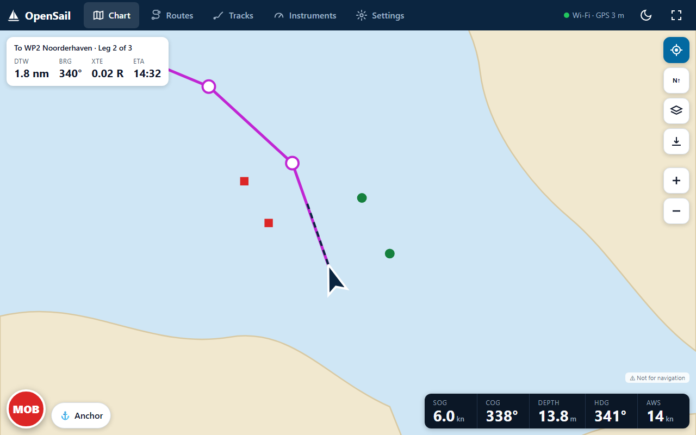 | 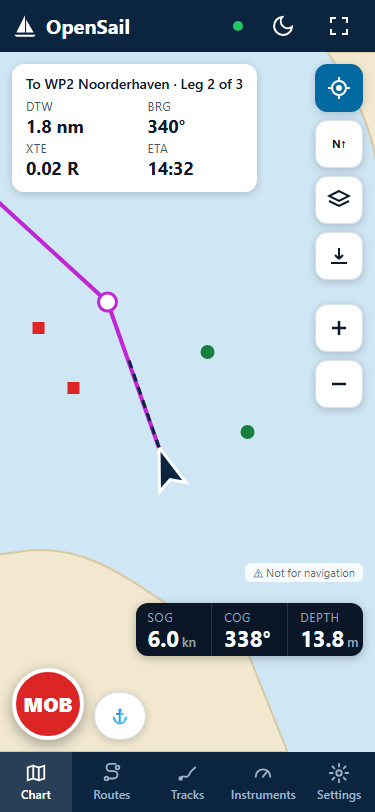 |

- **Chart is home.** `/` opens the chart, as now.
- **Five destinations**, one place each: **Chart, Routes, Tracks, Instruments, Settings**.
  - ≥ 1024 px: tabs in a dark app bar at the top (icon + label, 48 px tall).
  - < 1024 px: a **bottom navigation bar** (60 px, thumb reach), the top bar only holds the
    name, a connection status dot, night mode and full screen.
  - **Logbook is hidden** until it exists (it is a placeholder today). The route stays, so
    nothing breaks.
- **The Tools sidebar is removed**, with the mobile ⋮ menu. Every working function it pointed
  to already has a home (table in 1.2).
- **App bar right side**: connection/GPS status chip ("Wi-Fi · GPS 3 m"; red when data stops),
  night mode, full screen. On Windows and Android full screen is real (Tauri window / Android
  immersive mode) via `pwa/src/platform/`; in the browser it is the Fullscreen API.

### 2.2 The chart screen

- **Right edge, one column of 48 px map buttons**: Follow vessel (on/off), Orientation (one
  toggle, N↑ / H↑), **Layers** (new sheet: seamarks, inland ENC, routes, tracks, AIS; this
  replaces the dead "Show navigation aids / depth contours" settings), Offline charts, Zoom
  +/-. MapLibre's own small zoom control is replaced by these.
- **Top left: route guidance card** while navigating (DTW, BRG, XTE, ETA, waypoint name). The
  route picker moves to the Routes page only ("Navigate" there); the chart card has "Stop".
- **Bottom right: instrument data bar** (SOG, COG, DEPTH, HDG, AWS on wide screens; SOG, COG,
  DEPTH on a phone). A cell turns red when its alert fires. Tapping it opens Instruments.
- **Bottom left: safety cluster, always on screen** on every page: MOB (72 px, red) and an
  **Anchor** button next to it (48 px) that opens the anchor watch panel, or shows its status
  pill when a watch runs. Anchor watch becomes one tap everywhere.
- Larger vessel marker (about 36 px) with a heading line.
- Layers sheet: 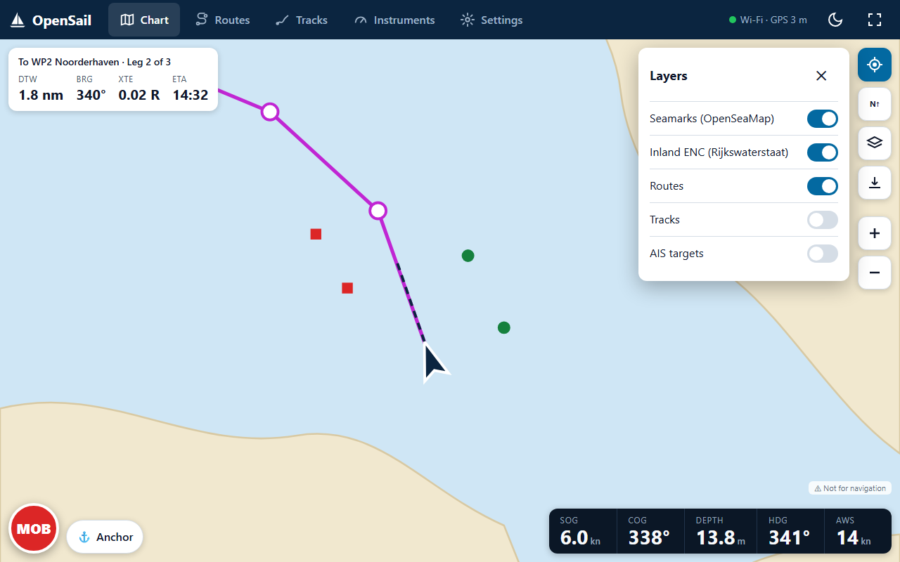

### 2.3 Other screens

- **Routes / Tracks**: list + map side by side from 1024 px; below that the map on top (45 %)
  and the list below, never a 55 px map. Track recording also gets a "● Rec" toggle in the
  Tracks tab header and its state shows as a red dot on the Tracks tab, so you see it from the
  chart. 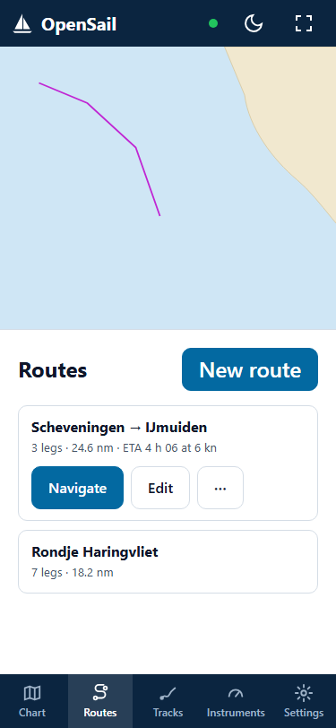
- **Instruments**: gauges first, then one "Connection" card (type, state, Disconnect). The raw
  JSON log and the tips move behind "Show raw data" / "Help". "Configure" becomes "Edit layout".
- **Settings**: grouped as Boat & units · Chart · Navigation sources · Alarms · Offline charts ·
  Account · About, with a section index on wide screens. **Remove** the settings nothing reads
  (Theme, nav aids, contours, the whole Instrument Preferences block, collision distance,
  weather alerts, Offline mode, Auto-sync). Theme comes back as **Display: Day / Night (red) /
  Auto**. Browser compatibility moves to About.
  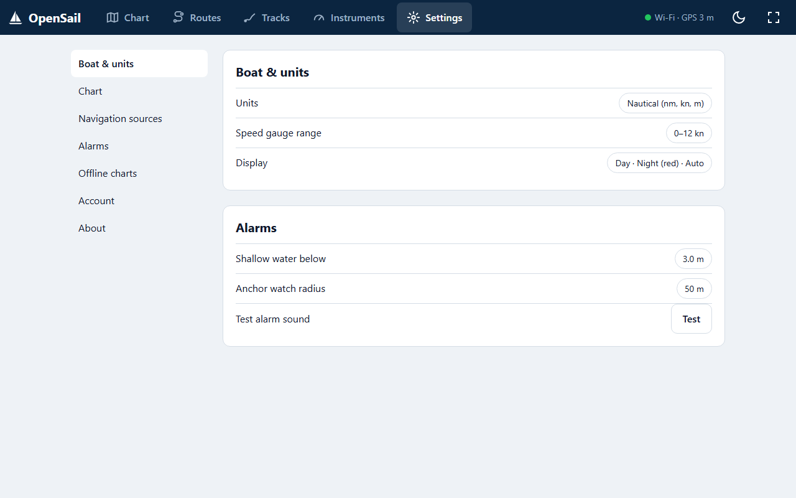

### 2.4 Visual system

- **Colour tokens** (CSS variables in `index.css`, used through Tailwind 4 `@theme`):
  navy app bar `#0b2540`, accent `#0369a1` (5.9:1 on white), danger `#dc2626`, ok `#15803d`,
  warn `#b45309`, text `#0f172a` / muted `#475569` on `#eef2f6`. All text ≥ 4.5:1, numbers on
  gauges ≥ 7:1 for sunlight. Red/green only together with position or a label (colour blind).
- **Night mode** (red on black, no white anywhere) for the UI and gauges; the chart gets a
  dimmed, red-tinted style. Day is the default; Auto follows sunset at the boat's position.
  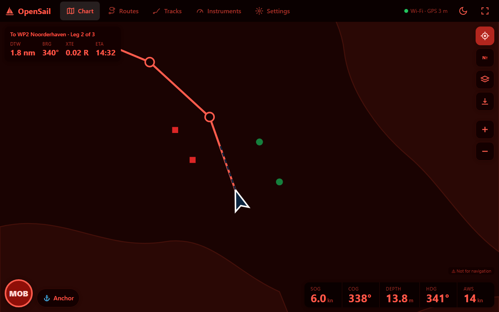
- **Type scale** 12 / 14 / 16 / 20 / 28 px for UI, 40–64 px tabular numerals for instrument
  values. System font (Segoe UI on Windows, Roboto on Android), no web font download.
- **Spacing** on a 4 px grid (4, 8, 12, 16, 24, 32); corner radius 12 px for cards and map
  buttons.
- **Touch targets ≥ 48 px** everywhere (above the 44 px minimum, for wet fingers and a moving
  boat). MOB 72 px.
- **Icons**: one stroke icon set (inline SVG, e.g. Lucide-style), no emoji.

### 2.5 Gauges, one consistent design

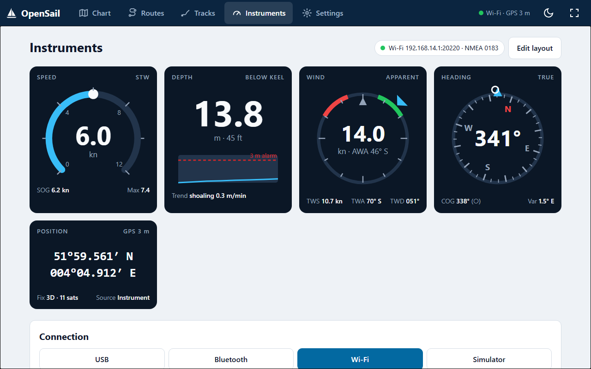

All gauges share one card: label top left, reference top right (STW / APPARENT / TRUE / BELOW
KEEL), the value as the largest thing in the card, secondary values in a footer row, and a red
outline when an alert fires.

- **Speed**: 270° dial with the arc filling to the value and the number in the middle; no
  needle. Range set per boat (default 0–12 kn, Settings → Boat). Footer: SOG and max.
- **Depth**: big number with the colour turning amber near and red below the shallow limit, and
  a 2-minute trend line with the alarm limit drawn in.
- **Wind**: boat-relative dial, bow up, red (port) and green (starboard) close-hauled sectors,
  the pointer at the apparent wind angle. Centre: **AWS and "AWA 46° S"**. Footer: **TWS, TWA,
  TWD computed properly** from AWA, AWS, boat speed and heading (shown only when boat speed and
  heading are known). This fixes the "True" bug: the label says APPARENT, and "true" values
  only appear when they are really true.
- **Heading**: compass card that turns, lubber line at the top, N in red, COG as a small ring.
- **Position**: monospace lat/lon, fix quality in the footer.

### 2.6 What stays the same

Every feature stays reachable; routes (URLs) stay; the safety logic, alarms, data sources and
the platform layer (`pwa/src/platform/`) do not change. The web, Windows and Android apps keep
one shared frontend.

## 3. Decisions for the owner

1. **Navigation**: top tabs on wide screens, bottom bar below 1024 px, sidebar removed? (Yes
   recommended.)
2. **Logbook**: hide the tab until it is built? (Recommended.) Or keep it with "coming soon".
3. **Instrument data bar on the chart**: yes, with which values by default (proposed SOG, COG,
   DEPTH, HDG, AWS)?
4. **Night mode**: in scope now (recommended, and it is cheap once colours are tokens), or later?
5. **Dead settings**: remove them (recommended), or wire them up (Theme → Day/Night is the only
   one worth wiring now; nav aids/contours become the Layers sheet).
6. **Speed gauge range**: default 0–12 kn and a setting per boat?
7. **True wind**: compute TWS/TWA/TWD from apparent wind and boat speed (recommended), or only
   relabel apparent wind for now?

## 4. Implementation plan (after approval)

Small PRs against `main`, each with before/after screenshots and the full check list (eslint,
`tsc -b`, vitest, Playwright chromium + accounts, server tests):

1. **Gauge fixes**: speed geometry, wind "True" bug + true wind calculation, consistent gauge
   card (smallest change with the most visible gain; independent of the layout).
2. **Design tokens + icons**: colour variables, type scale, SVG icon set, 48 px buttons; no
   layout change yet.
3. **Navigation**: new app bar + bottom nav, remove sidebar and mobile menu, hide Logbook,
   safety cluster with the Anchor button. Update e2e tests that use `Toggle sidebar`,
   `Toggle mobile menu`, `Anchor Watch`, `Man Overboard` (sidebar) to roles/labels of the new
   controls.
4. **Chart screen**: map button column, Layers sheet, data bar, route card, bigger vessel.
5. **Routes/Tracks/Instruments/Settings** tidy-up, dead settings removed (with a Dexie settings
   migration that drops the unused keys).
6. **Night mode** (if approved). Final PR: run `android.yml` and `desktop.yml` by hand.

E2E tests that rely on today's selectors: `accounts`, `chart-display`, `chart-follow`,
`chart-management`, `helpers/charts.ts`, `man-overboard`, `performance`, `phone-layout`,
`responsive-design`, `safety-alarms`, `track-to-route`.
